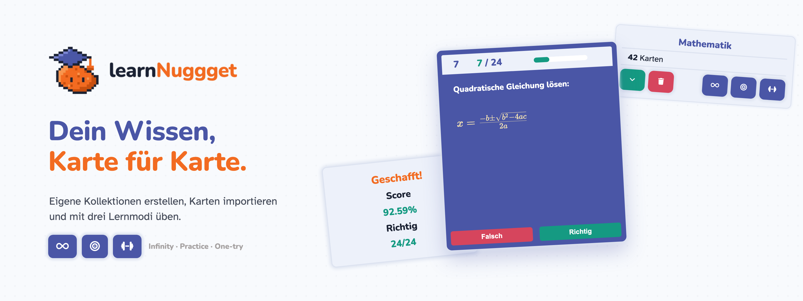
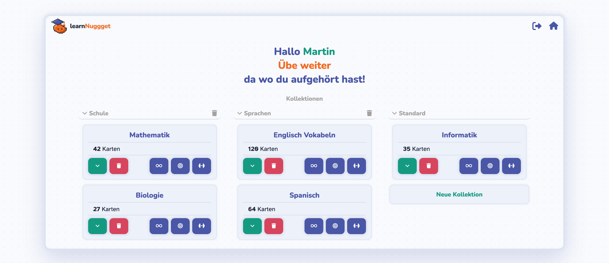
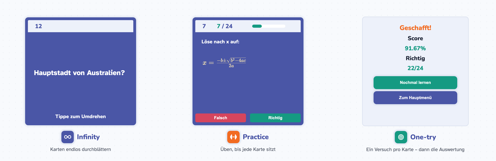

<p align="center">
  
</p>

# learNuggget

**learNuggget** ist eine Flashcard-Web-App zum Lernen mit Karteikarten. Du legst eigene Kollektionen an, ordnest sie in Gruppen, füllst sie mit Karten (auch mit LaTeX-Formeln) und übst sie in drei Lernmodi. Die App hat Benutzerkonten, sodass jede Person nur ihre eigenen Gruppen, Kollektionen und Karten sieht.

> **Status:** Das Projekt ist in aktiver Entwicklung. Konten, Gruppen, Kollektionen, Karten und alle drei Lernmodi funktionieren. Scores werden bisher nur während der aktuellen Runde berechnet und noch nicht gespeichert. Mehr dazu unter [Roadmap](#roadmap).

<p align="center">
  
</p>

## Inhaltsverzeichnis

- [Funktionen](#funktionen)
- [Lernmodi](#lernmodi)
- [Verwendete Technologien](#verwendete-technologien)
- [Installation und Start](#installation-und-start)
- [Projektstruktur](#projektstruktur)
- [API-Übersicht](#api-übersicht)
- [Roadmap](#roadmap)
- [Lizenz](#lizenz)

## Funktionen

### Konten und Sicherheit

- Registrierung und Anmeldung mit Benutzername und Passwort
- Benutzername mit mindestens 5 Zeichen
- Passwort mit 8 bis 32 Zeichen, mindestens einem Groß- und einem Kleinbuchstaben und einer Zahl; verbreitete Passwörter werden abgelehnt
- Passwörter werden mit bcrypt gehasht gespeichert
- Anmeldung über eine Session: Der Token liegt in einem `HttpOnly`-Cookie, in der Datenbank wird nur sein Hash gespeichert. Eine Session ist 12 Stunden gültig
- Jede Person sieht und bearbeitet ausschließlich ihre eigenen Gruppen und Kollektionen

### Gruppen und Kollektionen

- Kollektionen in **Gruppen** einteilen, zum Beispiel nach Fach
- Gruppen erstellen und löschen; die Gruppe „Standard“ nimmt Kollektionen ohne eigene Gruppe auf
- Kollektionen innerhalb einer Gruppe erstellen und löschen (Löschen mit Bestätigung per zweitem Klick)
- Anzahl der Karten pro Kollektion auf einen Blick

### Karten

- Einzelne Karten mit Frage und Antwort hinzufügen
- Viele Karten auf einmal importieren (**Bulk-Import**) im Format `Frage@@Antwort;;`
- Karten während des Lernens löschen
- **LaTeX-Unterstützung** für Fragen und Antworten über [KaTeX](https://katex.org/): Formeln stehen zwischen `$$ … $$`, zum Beispiel `$$x = \frac{-b \pm \sqrt{b^2 - 4ac}}{2a}$$`

### Bedienung

- Karten umdrehen per Klick oder Tipp; in Infinity zusätzlich per Tastatur und Wischgeste
- Auswertung am Ende einer Runde mit Score und der Möglichkeit, direkt noch einmal zu lernen
- Das Design nutzt die Schriften Nunito und Atkinson Hyperlegible

## Lernmodi

<p align="center">
  
</p>

| Modus | Ablauf | Score |
| --- | --- | --- |
| **Infinity** | Karten beliebig lange durchblättern, ohne Bewertung und ohne Ende. | kein Score |
| **Practice** | Karten als richtig oder falsch markieren. Richtig beantwortete Karten verlassen die Runde, falsche bleiben zum Weiterüben. Die Runde endet, wenn alle Karten richtig beantwortet wurden. | `100 ÷ (1 + (falscheAntworten × 2) ÷ anzahlKarten)` |
| **One-try** | Jede Karte wird genau einmal beantwortet, ohne Wiederholung. Die Runde endet, sobald alle Karten bearbeitet wurden. | `(richtigeAntworten ÷ anzahlKarten) × 100` |

**Steuerung in Infinity:** `Leertaste` dreht die Karte um, `←` und `→` blättern zurück und vor. Auf Touch-Geräten wischst du nach links oder rechts.

> Der Score wird nach jeder Runde angezeigt, aber noch nicht gespeichert. Die Anzeige „Markierte Karten lernen“ und der Stern-Button sind bereits im Design vorhanden, haben aber noch keine Funktion (siehe [Roadmap](#roadmap)).

## Verwendete Technologien

| Bereich | Technologie |
| --- | --- |
| Frontend | [Svelte 5](https://svelte.dev/), [Vite](https://vite.dev/) |
| Formeln | [KaTeX](https://katex.org/) |
| Icons und Schriften | [Font Awesome](https://fontawesome.com/) und Google Fonts (Nunito, Atkinson Hyperlegible), eingebunden per CDN |
| Backend | [Go](https://go.dev/) mit [Gin](https://gin-gonic.com/) |
| Datenbank | SQLite (Go-Treiber [`modernc.org/sqlite`](https://pkg.go.dev/modernc.org/sqlite), ohne CGO) |
| Sicherheit | bcrypt für Passwörter, SHA-256-Hash für Session-Tokens |

## Installation und Start

### Voraussetzungen

- Node.js und npm
- Go (die benötigte Version steht in `backend/go.mod`)
- Internetverbindung beim Start im Browser, weil Schriften und Icons per CDN geladen werden

### Repository klonen

```bash
git clone https://github.com/MartinNagypal/learNuggget.git
cd learNuggget
```

### Backend starten

```bash
cd backend
go run .
```

Die API startet unter `http://localhost:3000`. Beim Start werden die benötigten SQLite-Tabellen angelegt (Benutzer, Sessions, Gruppen, Kollektionen und Karten). Die Datenbankdatei liegt danach unter `backend/learNuggget.db`.

### Frontend starten

Öffne ein zweites Terminal im Projektverzeichnis:

```bash
npm install
npm run dev
```

Öffne anschließend die Adresse, die Vite im Terminal anzeigt (standardmäßig `http://localhost:5173`). Vite leitet Anfragen unter `/api` an das Backend auf Port `3000` weiter. Registriere dich beim ersten Start über „Registrieren“ auf der Anmeldeseite.

### Produktions-Build

```bash
npm run build
```

> Das Backend erlaubt Anfragen nur von den in `backend/main.go` eingetragenen Adressen (CORS). Wenn du die App über eine andere Adresse aufrufst, musst du sie dort ergänzen. Das Session-Cookie ist derzeit nicht auf HTTPS beschränkt (`isProduction = false` in `backend/handlers/handleAuth.go`). Für einen öffentlichen Betrieb solltest du das ändern.

## Projektstruktur

```text
src/
  pages/        Anmeldung, Startseite und Lernseite
  lib/          Svelte-Komponenten (Karte, Kollektion, Gruppe, Auswertung, Topbar, …)
  style/        Styles und Design-Variablen (Farben, Schriften, Abstände)
backend/
  routes/       Registrierung der API-Routen
  handlers/     HTTP-Handler (Prüfung der Session, Parameter, Antworten)
  functions/    Datenbankzugriff und Anwendungslogik
docs/           Bilder für das README
public/         Logo und Icons
```

## API-Übersicht

Alle Endpunkte außer Registrierung und Anmeldung brauchen eine gültige Session (Cookie `sessionToken`). Im Frontend werden sie mit dem Präfix `/api` aufgerufen; Vite entfernt dieses Präfix beim Weiterleiten.

### Authentifizierung

| Methode | Endpunkt | Beschreibung |
| --- | --- | --- |
| `POST` | `/auth/register` | Konto erstellen und anmelden (JSON: `username`, `password`) |
| `POST` | `/auth/login` | Anmelden (JSON: `username`, `password`) |
| `GET` | `/auth/verifySession` | Prüfen, ob die Session gültig ist |
| `GET` | `/auth/logout` | Abmelden und Session löschen |
| `GET` | `/auth/username` | Benutzernamen der angemeldeten Person abrufen |

### Gruppen

| Methode | Endpunkt | Beschreibung |
| --- | --- | --- |
| `GET` | `/group/fetchall` | Alle Gruppen abrufen |
| `POST` | `/group/create?name=<name>` | Gruppe erstellen |
| `DELETE` | `/group/delete?gid=<id>` | Gruppe löschen |

### Kollektionen

| Methode | Endpunkt | Beschreibung |
| --- | --- | --- |
| `GET` | `/collections?gid=<id>` | Kollektionen einer Gruppe abrufen (`gid=0` ist „Standard“) |
| `POST` | `/collections/new?name=<name>&gid=<id>` | Kollektion in einer Gruppe erstellen |
| `DELETE` | `/collections/delete?id=<id>` | Kollektion und ihre Karten löschen |
| `GET` | `/collection/len?id=<id>` | Anzahl der Karten einer Kollektion abrufen |

### Karten

| Methode | Endpunkt | Beschreibung |
| --- | --- | --- |
| `GET` | `/cards?collectionID=<id>` | Karten einer Kollektion abrufen |
| `POST` | `/addSingleCard` | Einzelne Karte hinzufügen (JSON: `question`, `answer`, `collectionID`) |
| `POST` | `/addBulk?id=<id>` | Mehrere Karten hinzufügen (JSON: `bulk` im Format `Frage@@Antwort;;`) |
| `DELETE` | `/card/delete?id=<id>` | Karte löschen |

## Roadmap

Die folgenden Funktionen sind geplant, aber noch nicht umgesetzt. Was schon fertig ist, steht oben unter [Funktionen](#funktionen) und [Lernmodi](#lernmodi).

### Scores und Konten

- [ ] Letzten Score pro Kollektion und Lernmodus speichern
- [ ] Profil-Gesamtscore aus dem Durchschnitt aller Lernmodi und Kollektionen
- [ ] Anmeldesperre nach 5 fehlgeschlagenen Versuchen

### Soziales und Ranglisten

- [ ] Freunde hinzufügen und Scores vergleichen
- [ ] Globale Kollektionen, die der Root-Benutzer anlegt und alle sehen und bearbeiten können
- [ ] Highscore mit Benutzername bei globalen Kollektionen
- [ ] Globale Top 3 der Profile mit dem höchsten Profilscore

### Karten markieren und zufällig üben

- [ ] Einzelne Karten in einer Kollektion markieren (Stern-Button und „Markierte Karten lernen“ sind im Design schon angelegt)
- [ ] Nur markierte Karten üben und deren Anzahl anzeigen
- [ ] Zufällig 10 oder beliebig viele Karten aus allen Kollektionen üben
- [ ] Zufällige Kollektion mit zufälligem Lernmodus auswählen

### Darstellung

- [ ] Dark Mode
- [ ] Level-System
- [ ] Weitere Inhalte rendern: Code und Schaltzeichen (zusätzlich zu LaTeX)

## Lizenz

Dieses Projekt steht unter der MIT-Lizenz, siehe [LICENSE](LICENSE).

---

<p align="center">
  Martin Nagypal · by <b>ChickenNuggget</b>
</p>
